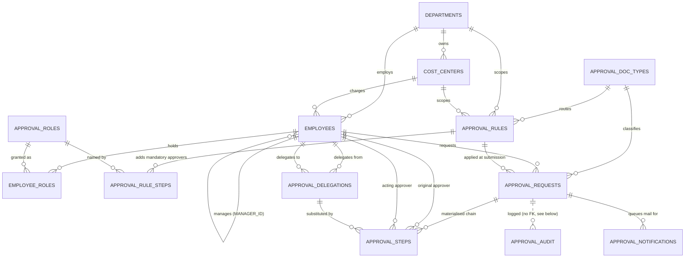

# Entity-relationship model

Fourteen tables in four groups. The dividing line that matters is between
**configuration** (org chart, rules, delegations — edited by people) and
**runtime** (requests, steps, audit — written only by `PKG_APPROVAL_ENGINE`).
Routing changes happen entirely in the first group.



## Configuration

| Table | Grain | Notes |
|---|---|---|
| `DEPARTMENTS` | one org unit | self-referencing, so departments can nest |
| `COST_CENTERS` | one charge code | scopes rules more finely than a department |
| `APPROVAL_DOC_TYPES` | one approvable object | adding "Contract" is a row, not a release |
| `APPROVAL_ROLES` | one named capacity | `CFO`, `FINANCE_CONTROLLER`, `APPROVAL_ADMIN` |
| `EMPLOYEES` | one person | `MANAGER_ID` is the routing spine |
| `EMPLOYEE_ROLES` | person × role | department-scoped or global |
| `APPROVAL_RULES` | one routing band | effective-dated, priority-ordered |
| `APPROVAL_RULE_STEPS` | extra approver on a rule | where parallel groups are declared |
| `APPROVAL_DELEGATIONS` | one proxy arrangement | date-ranged and optionally amount-capped |
| `APPROVAL_HOLIDAYS` | one non-working day | excluded from SLA arithmetic |

### The three columns that do the routing

`EMPLOYEES.MANAGER_ID` gives the walk its edges. `EMPLOYEES.JOB_LEVEL`
(1 = individual contributor, 10 = CEO) and `EMPLOYEES.APPROVAL_LIMIT` give the
walk its stopping conditions. Everything else about a person is descriptive.

### How a rule is chosen

At submission the engine picks exactly one rule, by:

1. `DOC_TYPE` match, `ACTIVE_FLAG = 'Y'`, and today inside `VALID_FROM`/`VALID_TO`
2. amount inside `[MIN_AMOUNT, MAX_AMOUNT)` — upper bound exclusive, `NULL` = unbounded
3. `DEPT_ID` and `COST_CENTER` either match the request or are `NULL` (wildcard)
4. lowest `PRIORITY` wins; ties broken by most specific scope, then oldest rule

Overlapping bands are legal and useful (that is how a department override beats a
global tier). Overlaps that are *also* equal on priority are not: they make
routing a coin flip, so `TRG_APPROVAL_RULES_AIU` rejects them and
`V_APPROVAL_RULE_OVERLAPS` shows you the pair.

### How a rule shapes the chain

| Column | Effect on the walk |
|---|---|
| `START_AT_LEVEL` | managers below this level are passed through, not asked |
| `MIN_APPROVER_LEVEL` | the walk cannot stop before reaching this level |
| `TOP_JOB_LEVEL` | the walk stops here even if the amount is not covered |
| `MAX_LEVELS` | hard cap on chain length |
| `LIMIT_MODE` | `INDIVIDUAL` / `CUMULATIVE` / `NONE` — see below |
| `REQUIRE_COVERAGE` | `Y` refuses to route what nobody in reach can authorise |
| `SKIP_INACTIVE`, `COLLAPSE_DUPLICATES`, `APPLY_DELEGATIONS`, `ALLOW_SELF_APPROVAL` | the exclusion switches |
| `FALLBACK_ROLE_CODE` | who approves when the walk yields nobody |
| `SLA_HOURS`, `REMINDER_HOURS`, `ESCALATE_AFTER_HOURS`, `MAX_ESCALATIONS` | the clock |

`LIMIT_MODE` is the one genuinely contestable choice:

- **`INDIVIDUAL`** — climb until one approver's own `APPROVAL_LIMIT` covers the
  amount. This is what delegation-of-authority policies normally mean, and it is
  the default.
- **`CUMULATIVE`** — climb until the running *sum* of limits covers the amount.
  Produces longer chains and treats authority as additive.
- **`NONE`** — ignore money; stop at `MIN_APPROVER_LEVEL`.

Both money modes are implemented because the requirement asked for cumulative
and the industry norm is individual. Pick per rule; the seed data uses
`INDIVIDUAL` for requisitions and `CUMULATIVE` for travel so both paths stay
exercised.

## Runtime

| Table | Grain | Written by |
|---|---|---|
| `APPROVAL_REQUESTS` | one submitted document | engine (drafts may be inserted by a form) |
| `APPROVAL_STEPS` | one approver on one request | engine only |
| `APPROVAL_AUDIT` | one attempted action | engine, autonomously; append-only |
| `APPROVAL_NOTIFICATIONS` | one queued email | engine enqueues, Automation drains |

### Request state machine

```
                 ┌──────────── recall ─────────────┐
                 v                                 │
  (create) → DRAFT ── submit ──→ PENDING ──────────┤
                 ^                 │  ^            │
                 │                 │  │            │
              RECALLED ── submit ──┘  └─ provide ──┴── INFO_REQUESTED
                                              info          ^
                                                            │ request_info
   PENDING ── all groups approved ──→ APPROVED  (terminal)
   PENDING ── any step rejected ────→ REJECTED  (terminal)
   any live state ── withdraw ──────→ WITHDRAWN (terminal)
```

`RECALL` and `WITHDRAW` are deliberately different verbs. Recall parks the
document on the requester's desk and can be undone by resubmitting — which
re-resolves the chain against the org chart *as it is now*. Withdraw is final.

### Step state machine

`PENDING` → `ACTIVE` (its group's turn) → `APPROVED` | `REJECTED`, with three
side exits: `SKIPPED` (an any-one-of sibling got there first), `CANCELLED`
(the request ended underneath it), `INFO_REQUESTED` (parked, SLA clock stopped).

### Sequential and parallel

`GROUP_NO` is the unit of execution; `STEP_SEQ` is only display order. All steps
in a group activate together, and the group's `STEP_MODE` decides when it closes:

- `SEQ` — one step in the group, closes when it is approved
- `ALL` — closes when every step in the group is approved (all-of)
- `ANY` — closes on the first approval; the siblings become `SKIPPED` (any-one-of)

Hierarchy steps are always `SEQ`. Parallel groups come from `APPROVAL_RULE_STEPS`
rows that share a `GROUP_NO`.

### Original versus acting approver

Every step carries both. `ORIGINAL_APPROVER_ID` is the position holder, and all
authority checks — limit, level — are evaluated against them. `ACTING_APPROVER_ID`
is whoever may actually click Approve after delegation, reassignment or
escalation. Keeping both is what lets the audit trail say *whose authority was
used* as well as *who used it*.

### Why `APPROVAL_AUDIT` has no foreign keys

The logger runs in an autonomous transaction so that a refused action is still
recorded. An autonomous transaction cannot see its parent's uncommitted rows, so
an FK to `APPROVAL_REQUESTS` would raise `ORA-02291` the first time the engine
logged the creation of a brand-new request. `REQUEST_REF` and `DOC_TYPE` are
denormalised onto every audit row so the log reads on its own.
